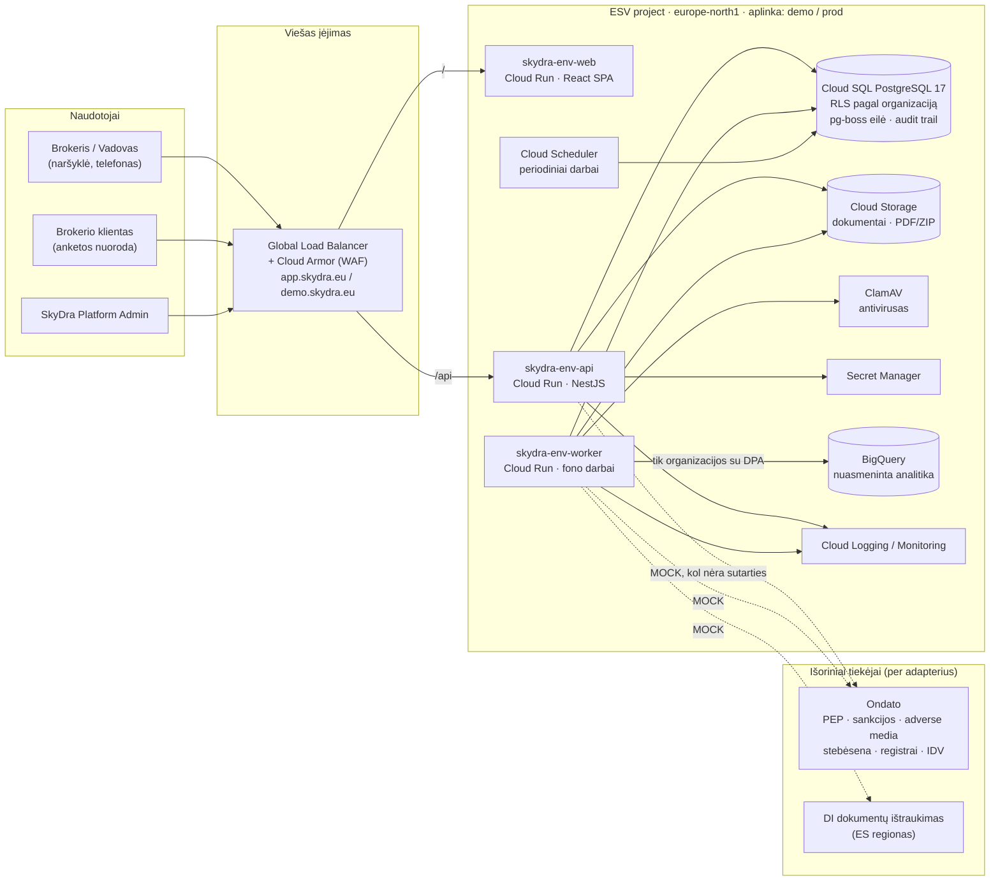
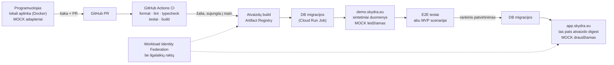

# SkyDra – architektūros ir eigos diagramos

Diagramos papildo [architecture.md](architecture.md) ir vaizduoja beveik galutinį MVP sprendimą. Punktyrinės linijos žymi integracijas, kurios dabar veikia per imitacinį adapterį (`MOCK`) ir vėliau bus pakeistos tikru tiekėju.

## 1. Sistemos architektūra (GCP, europe-north1)

## 2. AML sandorio bylos eiga

```mermaid
flowchart TD
    start(["Brokeris sukuria bylą"]) --> tx["Sandorio duomenys<br/>tipas · objekto paskirtis · vertė / nuoma · stadija"]
    tx --> applies{"AML taikomas?<br/>pirkimas–pardavimas arba<br/>nuoma ≥ 10 000 EUR/mėn."}
    applies -->|"Ne"| na["Būsena: netaikomas pagal<br/>nuomos vertės kriterijų"]
    na --> trigger{"Kitas AML pagrindas?<br/>įtarimas · PEP · sankcijos"}
    trigger -->|"Ne"| close_na(["Byla administruojama<br/>be AML eigos"])
    trigger -->|"Taip"| parties
    applies -->|"Taip"| parties["Šalys: neribotas skaičius<br/>fizinis / juridinis asmuo, vaidmuo"]

    parties --> intake{"Duomenų surinkimas"}
    intake -->|"Brokeris suveda"| kyc["KYC duomenys ir dokumentai"]
    intake -->|"Kliento anketa per nuorodą"| kyc
    kyc --> idv["Tapatybės patikra<br/>fizinė (brokeris) · nuotolinė (MOCK)"]

    idv --> legal{"Juridinis asmuo?"}
    legal -->|"Taip"| ubo["Nuosavybės grandinė ir UBO<br/>registrai (MOCK) · išrašai + ištraukimas<br/>netiesioginių dalių skaičiavimas"]
    ubo --> disc{"UBO neatitikimas?"}
    disc -->|"Taip"| discflow["Neatitikimo eiga<br/>REVIEW_REQUIRED · pranešimo projektas"]
    discflow --> screening
    disc -->|"Ne"| screening
    legal -->|"Ne"| screening

    screening["Patikros visiems susijusiems asmenims<br/>sankcijos · PEP · adverse media · RE"] --> hit{"Galimas sutapimas<br/>≥ 85 %?"}
    hit -->|"Taip"| review["Brokerio peržiūra<br/>FALSE_POSITIVE / TRUE_MATCH"]
    review -->|"Patvirtintas sankcijų sutapimas"| decline
    review --> risk
    hit -->|"Ne"| risk

    risk["Rizikos vertinimas LT-RISK-01<br/>LOW / MEDIUM / HIGH"] --> edd{"Sustiprintas patikrinimas?<br/>PEP · didelės rizikos šalis · HIGH"}
    edd -->|"Taip"| eddtasks["Lėšų ir turto šaltinis<br/>papildomi įrodymai"]
    eddtasks --> approval{"Reikia tvirtinimo?<br/>(PEP ir pagal matricą)"}
    approval -->|"Kelių naudotojų organizacija"| approver["Tvirtintojas ≠ bylos savininkas"]
    approval -->|"Solo brokeris"| self["Savarankiškas patvirtinimas<br/>su deklaracija"]
    approver --> decision
    self --> decision
    approval -->|"Ne"| decision
    edd -->|"Ne"| decision

    decision{"Sprendimas"} -->|"APPROVE / APPROVE_WITH_ENHANCED_MEASURES"| export
    decision --> decline["DECLINE / TERMINATE"]
    decline --> export
    export["PDF ataskaita + ZIP paketas<br/>SHA-256 · įrašas audit trail"] --> monitor["Tęstinė stebėsena<br/>pakartotinės patikros · next_review_date"]
    monitor -->|"Naujas sutapimas arba pokytis"| reopen["Byla atnaujinama<br/>Reopened → Completed"]
    reopen --> screening

    gates["Bylos užbaigimą blokuoja:<br/>NOT_ASSESSED · REVIEW_REQUIRED ·<br/>neišspręstas UBO · neužbaigtos užduotys"]
    gates -.-> decision
```

Visi veiksmai, sprendimai ir pataisos įrašomi į nekeičiamą audit trail. Kiekviename įraše saugomas ir tuo metu taikytas teisinis režimas (PPTFPĮ arba AMLR).

## 3. Aplinkos ir CI/CD

